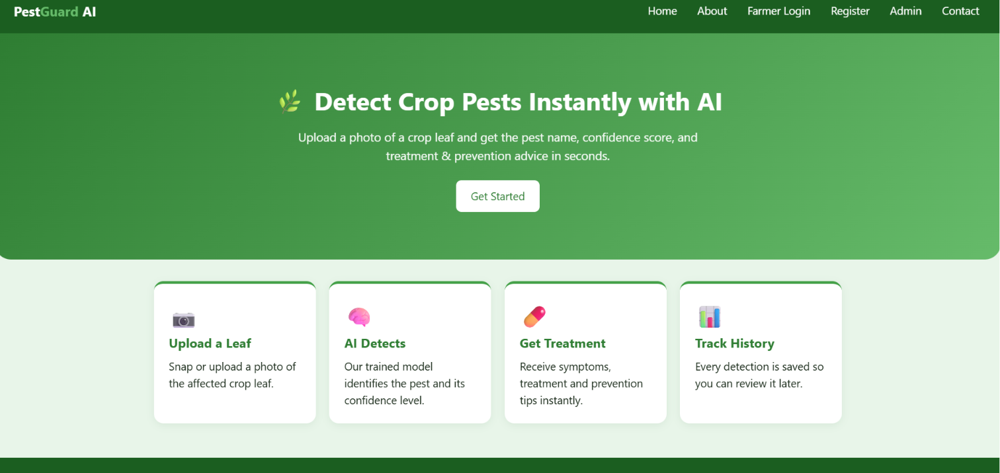
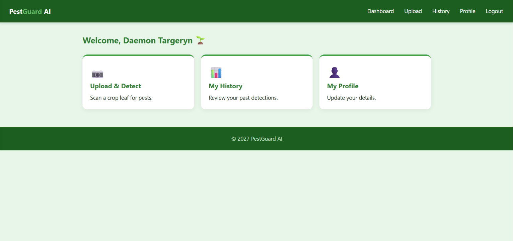
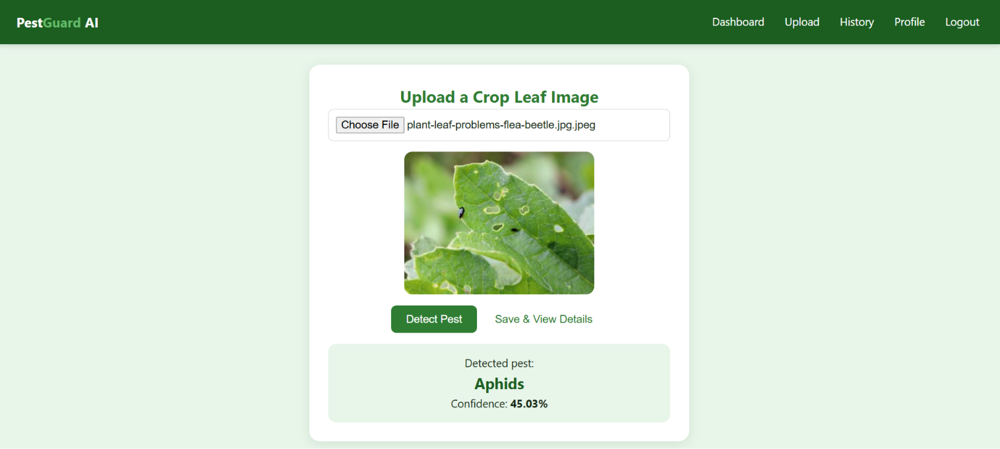
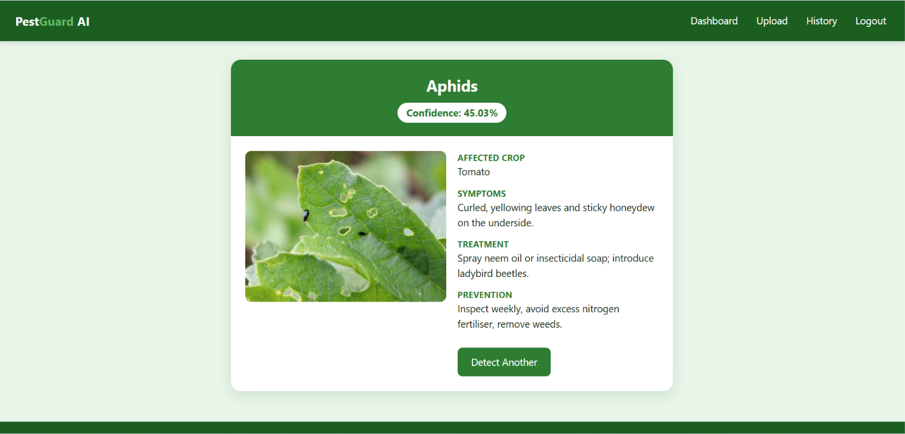
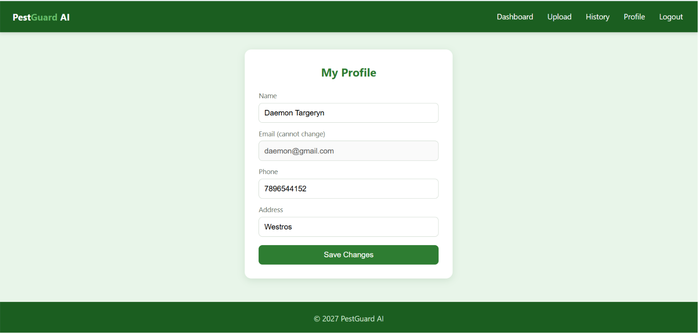
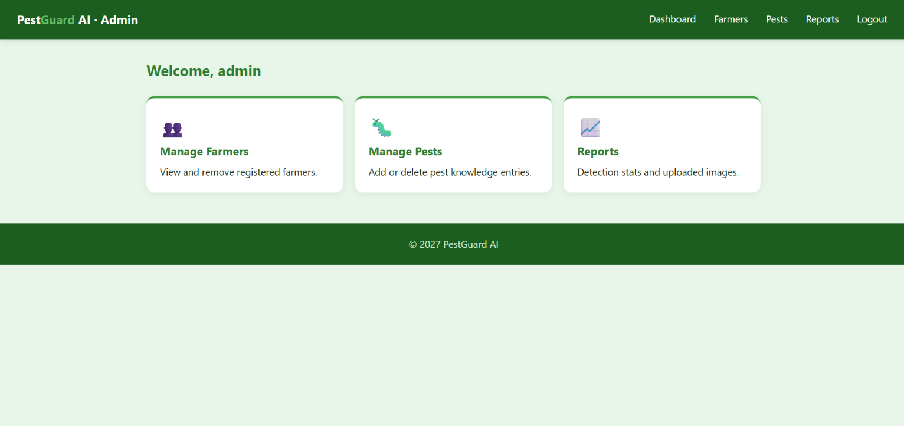

# 🌿 AI-Based Pest Detection and Crop Protection System

An AI-powered Java web application that helps farmers detect crop pests by uploading crop leaf images. The application integrates **Artificial Intelligence** with **Java Web Technologies** to identify pests and provide symptoms, treatment, and prevention methods using a MySQL database.

---

# 📖 Project Overview

The **AI-Based Pest Detection and Crop Protection System** is designed to help farmers identify crop pests quickly and accurately using Artificial Intelligence.

The application allows farmers to:

- Register and log in securely
- Detect pests using an AI model
- View prediction confidence
- Get pest details, symptoms, treatment, and prevention methods
- View previous detection history
- Update profile information

---

# ✨ Features

- 👨‍🌾 Farmer Registration & Login
- 🔐 Secure Authentication
- 🤖 AI-Based Pest Detection
- 📊 Confidence Score Display
- 🌱 Pest Information
- 💊 Treatment Recommendations
- 🛡️ Prevention Methods
- 📜 Detection History
- 👤 Farmer Profile Management
- 👨‍💼 Admin Dashboard
- 📈 Reports Module

---

# 🛠️ Technologies Used

## Frontend

- HTML5
- CSS3
- JavaScript
- JSP (Java Server Pages)

## Backend

- Java
- Java Servlets
- JDBC

## Database

- MySQL

## Artificial Intelligence

- Google Teachable Machine
- TensorFlow.js

## Web Server

- Apache Tomcat 9

## Build Tool

- Apache Maven

## IDE

- Visual Studio Code

---

# 🏗️ Architecture

The project follows the **MVC (Model-View-Controller)** Architecture.

```text
                User
                  │
                  ▼
      HTML + CSS + JavaScript + JSP
                  │
                  ▼
          Java Servlets (Controller)
                  │
                  ▼
             DAO Layer (JDBC)
                  │
                  ▼
             MySQL Database
```

### AI Workflow

```text
Crop Leaf Image
       │
       ▼
Google Teachable Machine
       │
       ▼
Predicted Pest
       │
       ▼
Detection Servlet
       │
       ▼
MySQL Database
       │
       ▼
Detection Result
```

---

# 📂 Project Structure

```text
AI-Based-Pest-Detection-System
│
├── database
│     └── schema.sql
│
├── screenshots
│     ├── admin.png
│     ├── dashboard.png
│     ├── details.png
│     ├── detection.png
│     ├── home.png
│     ├── login.png
│     ├── profile.png
│     └── registration.png
│
├── src
│    └── main
│         ├── java
│         └── webapp
│
├── pom.xml
├── README.md
└── .gitignore
```

---

# 🚀 How the System Works

1. Farmer logs into the application.
2. Selects a crop leaf image.
3. Google Teachable Machine classifies the image.
4. The predicted pest name and confidence score are generated.
5. The Java Servlet receives the prediction.
6. Pest information is fetched from the MySQL database.
7. Detection history is stored.
8. Complete pest information is displayed to the farmer.

---

# ⚙️ Installation Guide

## 1. Clone the Repository

```bash
git clone https://github.com/hemalathalakku/AI-Based-Pest-Detection-System.git
```

---

## 2. Import the Database

Import:

```text
database/schema.sql
```

into MySQL.

---

## 3. Configure Database Connection

Open:

```text
src/main/java/com/pestdetect/util/DBConnection.java
```

Update your MySQL credentials:

```java
USER = "root";
PASS = "your_mysql_password";
```

---

## 4. Install Apache Maven

Download and install Apache Maven from the official website.

Verify the installation:

```bash
mvn -version
```

---

## 5. Build the Project

Open the project in **Visual Studio Code**.

Run:

```bash
mvn clean package
```

---

## 6. Deploy

Deploy the generated WAR file to **Apache Tomcat 9**.

Open:

```text
http://localhost:8080/pest-detection-system/
```

---

# 🤖 AI Model

The application uses **Google Teachable Machine** to classify crop leaf images.

Supported classes:

- Aphids
- Healthy Leaf
- Leaf Blight

The TensorFlow.js model predicts the pest and sends the result to the Java backend, which retrieves detailed information from the MySQL database.

---

# 👤 Demo Login Credentials

## Farmer

**Email**

```text
hema@farm.com
```

**Password**

```text
farmer123
```

---

## Admin

**Username**

```text
admin
```

**Password**

```text
admin123
```

---

# 📸 Screenshots

## 🏠 Home Page



---

## 📝 Farmer Registration


---

## 🔐 Farmer Login


---

## 📊 Farmer Dashboard



---

## 🤖 AI Detection Result



---

## 🌱 Pest Details



---

## 👤 Farmer Profile



---

## 👨‍💼 Admin Dashboard



---

# 🔮 Future Enhancements

- Support for additional crop diseases
- Mobile application
- Real-time camera-based pest detection
- Cloud deployment
- Weather-based disease prediction
- Multi-language support
- Email notifications
- Analytics dashboard

---

# 🎯 Learning Outcomes

Through this project, I gained practical experience in:

- Java Web Development
- MVC Architecture
- Java Servlets
- JDBC
- MySQL
- Apache Maven
- Apache Tomcat
- Google Teachable Machine
- TensorFlow.js Integration
- Session Management
- Authentication & Authorization
- Full-Stack Web Application Development

---

# 👩‍💻 Author

**Lakku Hema Latha**

B.Tech – Electronics and Communication Engineering (ECE)

Lakireddy Bali Reddy College of Engineering (LBRCE)

GitHub: https://github.com/hemalathalakku

---

## ⭐ If you found this project useful, please consider giving it a Star!